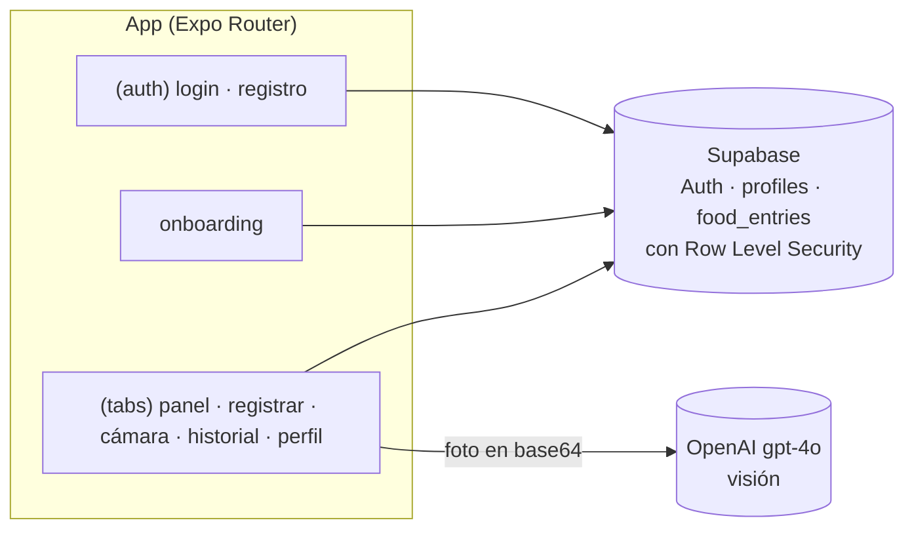

# App Fit

App móvil de nutrición: registro de comidas y macronutrientes, metas diarias, historial y
**análisis de fotos de comida con IA de visión**, que identifica cada ingrediente del plato y
estima sus calorías y macros.

> Proyecto personal en desarrollo (mayo–junio de 2026). Es un prototipo: funciona en local con
> Expo y un proyecto propio de Supabase, pero no está publicado en tiendas.

## Funcionalidades

- **Cuenta y perfil:** registro e inicio de sesión con Supabase, y onboarding con edad, peso,
  estatura y metas de calorías, proteínas, carbohidratos y grasas.
- **Foto del plato:** la cámara o la galería mandan la imagen a un modelo de visión, que devuelve
  cada ingrediente por separado con sus macros por unidad y la cantidad estimada.
- **Registro manual** de comidas por tipo (desayuno, comida, cena y snack).
- **Panel del día:** anillo de calorías, barras y anillos de macros y registro de agua.
- **Historial** por fecha.

## Stack

| Capa | Tecnología |
|---|---|
| App | Expo SDK 56 con Expo Router, React Native, TypeScript |
| Datos y autenticación | Supabase: Auth, PostgreSQL y Row Level Security |
| IA | OpenAI `gpt-4o` con visión, llamado con `fetch` |
| Gráficas | react-native-chart-kit, react-native-svg |
| Cámara | expo-camera, expo-image-picker |

## Arquitectura



Cada usuario solo puede leer y escribir sus propios registros: las políticas de RLS de
`supabase-setup.sql` lo garantizan en la base de datos, no en la app.

## Cómo correr en local

1. Crea un proyecto en Supabase y ejecuta `supabase-setup.sql` en su editor SQL.
2. Variables de entorno:

   ```bash
   cp .env.example .env
   ```

3. Instala y arranca:

   ```bash
   npm install
   npx expo start
   ```

   Abre la app con Expo Go en el teléfono o en un emulador.

## Limitaciones conocidas

- **La clave de OpenAI viaja dentro de la app:** todo lo que empieza con `EXPO_PUBLIC_` queda en el
  paquete compilado. Sirve para probar en local; para publicarla, la llamada a la IA tiene que
  pasar por un backend (por ejemplo, una Edge Function de Supabase).
- Faltan pruebas automatizadas y capturas.

## Mi rol

Proyecto personal: diseño y desarrollo completos de la app, del modelo de datos con RLS y del
análisis de fotos con IA.

---

## English summary

**App Fit** is a personal, in-progress nutrition app built with Expo (React Native, TypeScript)
and Supabase (Auth, PostgreSQL with Row Level Security). It logs meals and macros against daily
goals and analyzes food photos with OpenAI `gpt-4o` vision, returning each ingredient with
per-unit macros. Known limitation: the OpenAI key is bundled in the client and should move behind
a backend before any public release.
